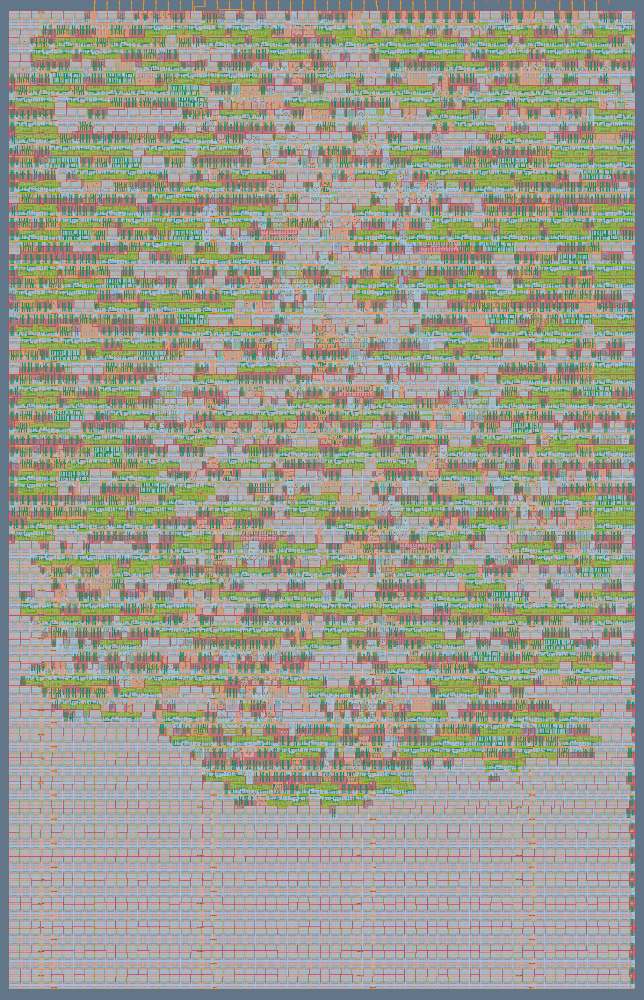
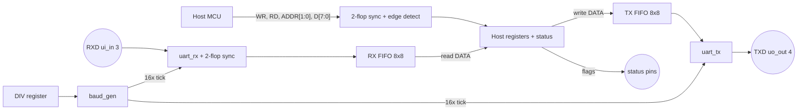
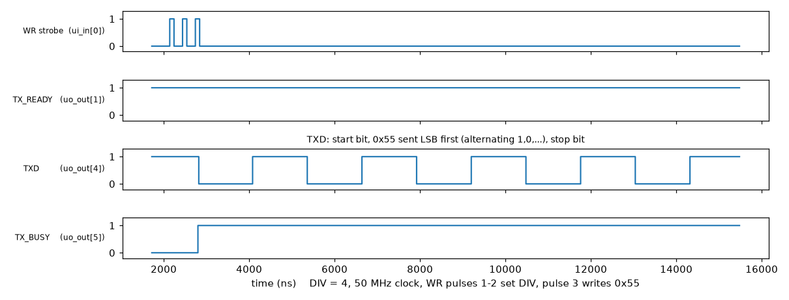

# UART Controller ASIC (Tiny Tapeout, IHP SG13, open-source RTL-to-GDS)

A UART in Verilog-2005: baud generator, transmitter, 16x-oversampling receiver and two 8-byte FIFOs, with a
simple 8-bit host bus. It goes from RTL to a checked GDSII layout with only open-source tools (Icarus Verilog,
cocotb, Verilator, SymbiYosys, LibreLane) and runs fully in GitHub Actions. Top module:
`tt_um_anirudh_uart`.



## Features

- 8N1 frames, 16x oversampling RX with mid-bit sampling and glitch rejection
- Programmable 16-bit baud divider (reset value 27 = 115 741 baud at 50 MHz)
- 8-byte TX FIFO and 8-byte RX FIFO
- Sticky flags: framing error, RX overrun, TX write rejected
- 2-flop synchronizers on RXD and on every host-bus input

## Block diagram



## Pin map

Follows the Tiny Tapeout UART convention (`ui_in[3]` = RX, `uo_out[4]` = TX).

| Pin | Dir | Function |
|-----|-----|----------|
| `ui_in[0]` | in | WR strobe |
| `ui_in[1]` | in | RD strobe |
| `ui_in[3]` | in | RXD |
| `ui_in[5:4]` | in | ADDR[1:0] |
| `uo_out[0]` | out | RX_AVAIL |
| `uo_out[1]` | out | TX_READY |
| `uo_out[2]` | out | OVERRUN |
| `uo_out[3]` | out | FRAME_ERR |
| `uo_out[4]` | out | TXD |
| `uo_out[5]` | out | TX_BUSY |
| `uo_out[6]` | out | RX_FULL |
| `uio[7:0]` | bidir | data bus (driven by the chip only while RD is high) |

Registers, bus timing and the frame diagram are in [docs/spec.md](docs/spec.md) and [docs/info.md](docs/info.md).



## Run it locally

Needs Docker. Build the images once, then run (on Git Bash prefix `docker run` with `MSYS_NO_PATHCONV=1`):

```bash
docker build -t uart-dev tools
```

```bash
docker run --rm -v "$PWD":/work uart-dev sh tools/lint.sh
```

```bash
docker run --rm -v "$PWD":/work uart-dev sh tools/test.sh
```

Formal proof (bigger image, downloads the OSS CAD Suite):

```bash
docker build -f tools/Dockerfile.formal -t uart-formal tools
```

```bash
docker run --rm -v "$PWD":/work uart-formal bash -c "cd formal && sby -f sync_fifo.sby bmc"
```

Waveforms: `test/tb.fst` is written by every test run. Open it in [Surfer](https://surfer-project.org) or GTKWave.

## Results

All numbers come from the CI runs (GDS run 43791737435) or from local runs I saw the output of.

| Item | Result |
|------|--------|
| Tests (cocotb, RTL) | 10 / 10 pass: reset, TX byte and timing, RX byte, all 256 values in loopback, TX FIFO, RX overrun, framing error, baud change, 200-byte random stress, default divider |
| Tests (gate level, CI) | 10 cases, 0 failures |
| Test strength | 3 deliberately broken RTL copies were each caught |
| Code coverage | not measured |
| Formal (FIFO, bounded model check) | PASS at depth 24; 4 / 4 cover goals reached; 3 broken FIFOs each fail the proof. Proof uses the chip's real 8-bit data width |
| Tile / die | 1x2, 202 x 314 um (1x1 did not fit: 94.9 % utilisation, placement failed) |
| Cells | 1 922 standard cells, 275 flip-flops, 33 552 um2 of logic, 55.8 % utilisation |
| Hold buffers | 397 inserted by the timing repair |
| Setup slack (20 ns clock) | +13.23 ns worst (slow corner, 125 C) |
| Hold slack | +0.119 ns worst (fast corner) |
| DRC / LVS / antenna | 0 / 0 / 0 |
| Tiny Tapeout precheck | all 10 checks pass |

Raw metrics: [docs/gds_metrics.csv](docs/gds_metrics.csv).

## Known limits

- No parity, no hardware flow control.
- The first TX start bit can be up to 1/16 bit short (the 16x tick runs freely). The data bits are exact.
- A frame with a bad stop bit is still stored in the RX FIFO, with FRAME_ERR set.
- Not tested on silicon or on an FPGA.

## Layout of the repo

```
src/      RTL (5 modules)
test/     cocotb tests, testbench
formal/   SymbiYosys FIFO proof
docs/     spec, datasheet source, images, metrics
tools/    Docker images and helper scripts
.github/  CI: test, formal, gds, docs
```

Apache-2.0.
