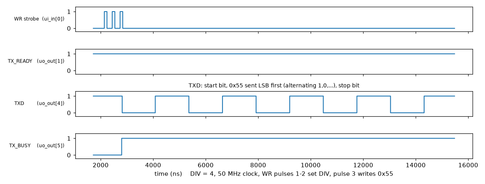

<!---

This file is used to generate your project datasheet. Please fill in the information below and delete any unused
sections.

You can also include images in this folder and reference them in the markdown. Each image must be less than
512 kb in size, and the combined size of all images must be less than 1 MB.
-->

## How it works

This is a UART (serial port) controller. It sends and receives bytes as 8N1 frames: one start bit, 8 data bits
(least significant bit first), one stop bit, no parity. An external microcontroller (MCU) talks to it through a
small parallel bus.

- **Baud generator** makes a "tick" 16 times per bit. `baud = f_clk / (16 * DIV)`. `DIV` is a 16-bit register
  that resets to 27, which gives 115 741 baud at 50 MHz (+0.47 % error).
- **Transmitter** takes the oldest byte from the 8-byte TX FIFO and shifts out the frame on `uo_out[4]` (TXD).
- **Receiver** synchronizes `ui_in[3]` (RXD) with two flip-flops, finds the start bit, re-checks it half a bit
  later, then samples every bit in the middle. A stop bit of 0 sets the framing-error flag. Good bytes go into
  the 8-byte RX FIFO. A byte that arrives while the RX FIFO is full is dropped and sets the overrun flag.
- **Host bus**: `uio[7:0]` is an 8-bit data bus, `ui_in[5:4]` is a 2-bit register address, `ui_in[0]` is the
  write strobe and `ui_in[1]` is the read strobe. All inputs are synchronized, and the chip acts on the rising
  edge of the strobe. The chip drives `uio` only while the read strobe is high.

Registers (ADDR on `ui_in[5:4]`):

| ADDR | Name | Read | Write |
|------|------|------|-------|
| 0 | DATA | pop a byte from the RX FIFO | push a byte to the TX FIFO |
| 1 | STATUS | status bits | write 1 to clear bits 7:5 |
| 2 | DIV_LO | `DIV[7:0]` | `DIV[7:0]` |
| 3 | DIV_HI | `DIV[15:8]` | `DIV[15:8]` |

STATUS bits: 0 RX_AVAIL, 1 TX_READY, 2 TX_BUSY, 3 RX_FULL, 4 TX_EMPTY, 5 TX_REJ (write to a full TX FIFO),
6 FRAME_ERR, 7 OVERRUN. Bits 5 to 7 stay set until cleared.

## How to test

1. Connect `ui_in[3]` to the TX pin of a USB-serial adapter (or use the demo board's RP2040 UART, which uses
   the same pins), and `uo_out[4]` to its RX pin. Use 115200 baud, 8N1, and a 50 MHz project clock.
2. **Send a byte:** put address 0 on `ui_in[5:4]` and the byte on `uio[7:0]`, wait about 100 ns, raise
   `ui_in[0]` for at least 100 ns, then lower it. The byte appears on TXD.
3. **Receive a byte:** wait for `uo_out[0]` (RX_AVAIL) to go high. Put address 0 on `ui_in[5:4]`, raise
   `ui_in[1]`, read `uio[7:0]` after at least 120 ns, then lower `ui_in[1]`.
4. **Check errors:** read STATUS (address 1). Clear sticky flags by writing 1s to bits 7:5.
5. **Other baud rates:** write `DIV` to addresses 2 and 3. `DIV = round(f_clk / (16 * baud))`.
   For example 9600 baud at 50 MHz needs `DIV = 326`.

Status is also on pins: `uo_out[0]` RX_AVAIL, `[1]` TX_READY, `[2]` OVERRUN, `[3]` FRAME_ERR, `[5]` TX_BUSY,
`[6]` RX_FULL.

## External hardware

A microcontroller (or any host) with 8 data lines plus 4 control lines for the bus, and a USB-serial adapter
or the Tiny Tapeout demo board's RP2040 for the serial side.
